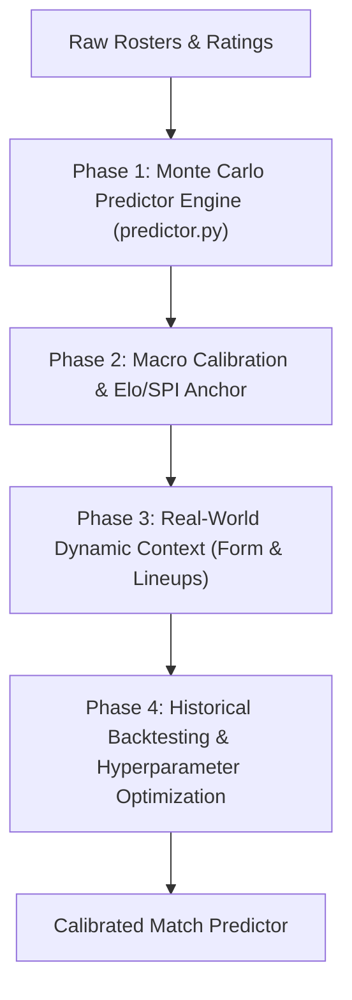

# Hattrk: Evolution from Match Simulator to Calibrated Predictor

## 1. Executive Summary & Current State Assessment

### Current State: Advanced Stochastic Simulator
Hattrk is currently a **bottom-up, event-based football match simulator**. It simulates minute-by-minute action using:
- Individual player attributes (FIFA / EA FC ratings: pace, shooting, passing, dribbling, defending, physical).
- Tactical systems and formations (4-3-3, 4-2-3-1, 3-5-2, etc.).
- Hand-tuned heuristic mechanics (fatigue curves, home advantage modifiers, dynamic xG calculations, red cards, discipline).

### Why It Is Not Yet a Real-World Predictor
| Dimension | Current Simulator | True Match Predictor |
| :--- | :--- | :--- |
| **Output Type** | Single simulated timeline (one match story). | Probability distribution across all possible outcomes: $P(\text{Home})$, $P(\text{Draw})$, $P(\text{Away})$, scoreline matrices. |
| **Parameter Foundation** | Video-game ratings and hand-tuned constants (`CHANCE_PER_MIN = 0.14`). | Statistically calibrated parameters fitted to real-world historical matches via loss minimization. |
| **Real-World Context** | Static rosters without form, injuries, suspensions, or fatigue from real fixtures. | Dynamic state: rolling 5-game xG form, player availability, fixture congestion, and team strength anchors (Club Elo / SPI). |
| **Validation Metric** | Plausibility checks (e.g. "Real Madrid usually beats Tottenham"). | Quantitative scoring: **Ranked Probability Score (RPS)**, Brier Score, and log-loss against real closing lines. |

---

## 2. Four-Phase Architectural Roadmap

---

### Phase 1: Monte Carlo Ensemble Predictor Module (`predictor.py`)

A single simulation has high variance. To generate predictive insights, we run an ensemble of simulations to extract probability distributions.

#### Key Deliverables:
1. **Headless High-Speed Execution**:
   - Programmatically disable all file I/O (`SAVE_SCORECARD = False`) and console prints.
   - Run $N = 500 \text{ to } 1,000$ iterations head-to-head.
2. **Probabilistic Outputs**:
   - **Match Outcome**: $P(\text{Home Win})$, $P(\text{Draw})$, $P(\text{Away Win})$.
   - **Expected Goals (xG)**: Average home and away goals across runs.
   - **Scoreline Matrix**: Ranked list of most probable exact scores (e.g., `1-1: 13.2%`, `2-1: 10.5%`, `1-0: 9.8%`).
   - **Market Metrics**:
     - Over / Under 1.5, 2.5, 3.5 goals.
     - Both Teams to Score (BTTS) Yes/No %.
     - Goal Margin distribution (blowouts $\ge 3$ goals vs tight wins).
   - **Player Prop Probabilities**:
     - Anytime Goalscorer percentages.
     - Yellow/Red card probabilities per player.
3. **CLI & JSON Export**:
   - Command interface: `python predictor.py --home "Real Madrid" --away "Spurs" --runs 1000 --json output.json`

---

### Phase 2: Macro Calibration & Bayesian Prior (Elo / SPI Anchor)

Relying purely on individual FIFA attributes creates blind spots (e.g., highly-rated individual players in a poorly performing team vs a cohesive mid-table side).

#### Key Deliverables:
1. **Team Power Anchor**:
   - Integrate an empirical team baseline (such as [Club Elo](http://clubelo.com/) or Opta Power Rankings).
   - Use team Elo difference to establish expected goal differentials:
     $$\lambda_{\text{home}} - \lambda_{\text{away}} = f(\Delta \text{Elo} + \text{HomeAdvantage})$$
2. **Bayesian Prior Integration**:
   - The micro-simulator (individual player matchups, tactical styles, fatigue) generates the match narrative and variance.
   - The aggregate expected outcomes are anchored by the macro team ratings, preventing attribute distortion.

---

### Phase 3: Real-World Dynamic Context & Tactical Archetypes

Real matches are strongly influenced by momentum, tactical friction, and player availability.

#### Key Deliverables:
1. **Rolling Form Modifier**:
   - Ingest team results over the last 5 matches.
   - Apply a momentum multiplier to shooting composure and pressing intensity based on rolling xG over/under-performance.
2. **Tactical Archetype Matchup Engine**:
   - High Press vs. Possession (counter-press vs. build-up resistance).
   - Low Block vs. High Line (counter-attack space vs. box congestion and long shots).
   - Target Man vs. Zonal Marking (aerial duel modifiers).
3. **Lineup & Absence Impact**:
   - Support custom starting XIs reflecting actual real-world injuries and suspensions.
   - Quantify "Drop-off Value" when key players (e.g. primary creators or starting GK) are missing.

---

### Phase 4: Backtesting & Automated Hyperparameter Optimization

To validate the model as a legitimate predictor, it must be evaluated against historical match data.

#### Key Deliverables:
1. **Historical Backtesting Pipeline**:
   - Ingest a complete historical league season (e.g., Premier League 2023/24 - 380 matches).
   - Simulate every fixture and compare predicted probabilities with actual outcomes.
2. **Objective Loss Scoring**:
   - **Ranked Probability Score (RPS)** (football industry benchmark):
     $$\text{RPS} = \frac{1}{2} \sum_{r=1}^{2} \left( \sum_{i=1}^{r} (p_i - o_i) \right)^2$$
   - **Brier Score** for binary markets (BTTS, Over 2.5).
   - **Log-Loss** comparison against market closing odds (Pinnacle/Betfair).
3. **Automated Tuning (Optuna / Nelder-Mead)**:
   - Formulate loss minimization to automatically calibrate engine constants:
     - `CHANCE_PER_MIN`
     - Defensive intervention multipliers
     - Home advantage scalar
     - Fatigue degradation rate

---

## 3. Recommended Implementation Order

1. **Step 1 (Immediate)**: Build `predictor.py` (Phase 1) to enable Monte Carlo ensemble predictions and generate probability distributions.
2. **Step 2**: Add Team Elo baseline to anchor team strength differentials (Phase 2).
3. **Step 3**: Introduce dynamic form and injury/lineup modifiers (Phase 3).
4. **Step 4**: Build backtesting harness and auto-tune weights against real match data (Phase 4).

