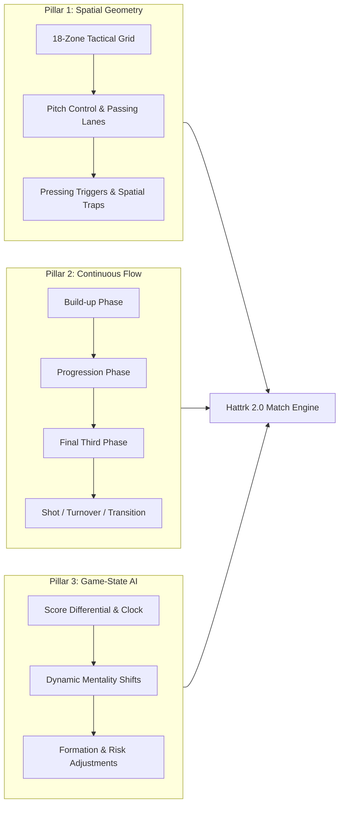
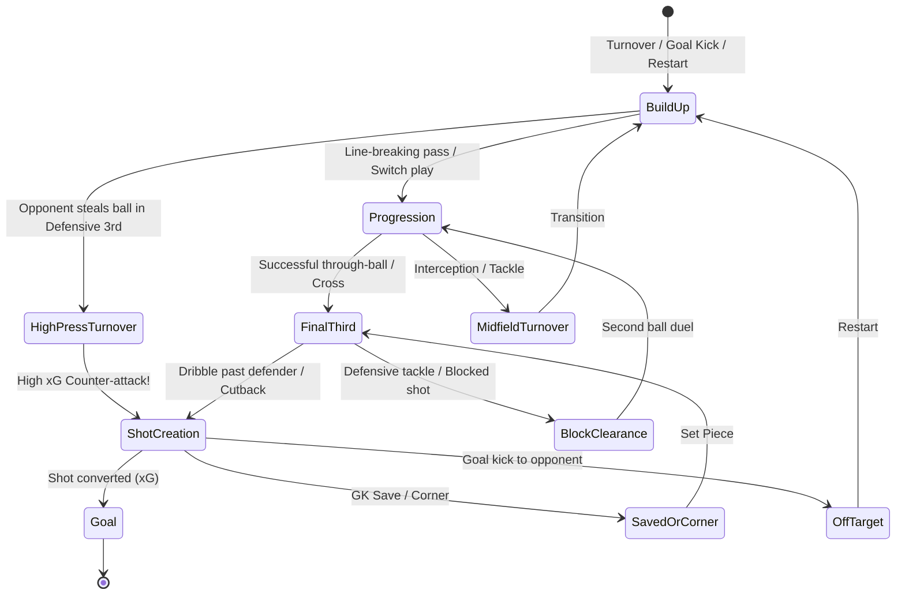

# Hattrk 2.0: Match Engine Realism & Spatial Architecture Plan

This document outlines the architectural plan to upgrade Hattrk from a **discrete heuristic event simulator** into an **accurate, phase-based, spatially grounded football match engine**.

---

## The Three Core Realism Pillars



---

## Pillar 1: Spatial Pitch Geometry (Zones, Passing Lanes & Pitch Control)

### 1. The 18-Zone Tactical Grid
Rather than requiring a heavyweight 3D physics engine, professional tactical analytics (Opta, StatsBomb, Guardiola's positional play) divide a $105 \times 68\text{m}$ pitch into **18 distinct tactical zones**:
- **3 Vertical Thirds**: Defensive Third, Middle Third, Attacking Third.
- **6 Horizontal Channels** per third: Left Wing, Left Half-Space, Central Left, Central Right, Right Half-Space, Right Wing.

```
       [ AWAY GOAL ]
+------+------+------+------+------+------+
|  Z13 |  Z14 |  Z15 |  Z16 |  Z17 |  Z18 |  Attacking Third (Box & Final 3rd)
+------+------+------+------+------+------+
|  Z7  |  Z8  |  Z9  |  Z10 |  Z11 |  Z12 |  Middle Third (Circulation & Pressing)
+------+------+------+------+------+------+
|  Z1  |  Z2  |  Z3  |  Z4  |  Z5  |  Z6  |  Defensive Third (Build-up & Low Block)
+------+------+------+------+------+------+
       [ HOME GOAL ]
```

### 2. Player Spatial Anchors & Formation Coordinates
- Each player in a formation (e.g., 4-3-3, 4-2-3-1, 3-5-2) has a **Home Zone** based on their assigned role:
  - Center-backs occupy Z3/Z4 in defense, step into Z9/Z10 in possession.
  - Inverted wingers occupy Z13/Z18, cut into Half-Spaces (Z14/Z17).
  - Defensive midfielders anchor Z9/Z10 to shield counter-attacks.
- **Dynamic Roaming**: Players roam $\pm 1$ zone based on their **Work Rate**, **Positioning**, and **Pace** attributes.

### 3. Pitch Control & Passing Lane Interception
- For any pass between `Zone_A` and `Zone_B`, the engine calculates **Passing Lane Interception Risk**:
  $$P(\text{Interception}) = \frac{\sum_{\text{defenders in lane}} (\text{Defending} + \text{Interceptions} + \text{Pace})}{\text{Passer Passing} + \text{Passer Vision} + \text{Distance Penalty}}$$
- If opponents overload a zone (e.g., 3 midfielders in Z9/Z10 vs. 1 midfielder), pass success through that zone drops significantly, forcing teams to circulate wide to the wings.

---

## Pillar 2: Continuous Possession & Phase-Based Flow

### 1. The Possession State Machine
Matches will no longer roll an arbitrary dice every minute. Instead, the match advances through **Possession Chains** composed of four sequential phases:



### 2. Micro-Possession Ticks & Realistic Pass Counts
- Each minute of match time contains **2 to 4 micro-possession decisions** (ticks).
- A possession chain logs real actions:
  - *Short pass, switch play, take-on, progressive carry, clearance.*
- This organically produces **400 to 650 completed passes per team per match**, matching real Premier League and Champions League data.
- **Passing Volume & Possession %**:
  $$\text{Possession} \% = \frac{\text{Successful Passes}_{\text{Home}}}{\text{Successful Passes}_{\text{Home}} + \text{Successful Passes}_{\text{Away}}} \times 100$$

### 3. Transition Dynamics (Counter-Attack vs. Rest Defense)
- **High Turnover Danger**: Losing the ball in the Defensive Third (Z1–Z6) yields immediate high-quality chances ($\text{xG} \ge 0.35$).
- **Rest Defense**: When a team attacks, their fullbacks and defensive midfielders must maintain a "rest defense" structure. If caught out of position, the opponent can trigger a **Fast Break** (exploiting vacated zones before defenders can recover).

---

## Pillar 3: Dynamic Game-State Adaptation (Tactical AI)

### 1. The Game-State Evaluation Matrix
Every 5 match minutes (and immediately after every goal or red card), each team's AI calculates its **Urgency & Risk Coefficient**:

$$\text{Urgency} = f(\Delta \text{Score}, \text{Time Remaining}, \text{Aggression Profile})$$

Where:
- $\Delta \text{Score} = \text{Goals}_{\text{MyTeam}} - \text{Goals}_{\text{Opponent}}$
- $\text{Time Remaining} = 90 - \text{Minute}$

### 2. Tactical Mentality Modes
Teams dynamically switch between 5 distinct tactical mentalities based on match circumstances:

| Mentality | Trigger Conditions | Tactical Adjustments | Risk / Reward Trade-off |
| :--- | :--- | :--- | :--- |
| **Park the Bus (Ultra-Defensive)** | Leading by 1+ after 78', or 10-man team protecting draw | All 10 outfield players drop to Defensive Third (Z1–Z6). No progressive runs. Clearances prioritized. | Minimizes opponent box entries; concedes high possession (65%+ to opponent) and zero counter threat. |
| **Controlled Counter** | Leading by 1–2 goals between 45' and 75' | Mid-block in Middle Third. Fast wingers hold positions near halfway line for long balls into open space. | High turnover conversion into fast breaks; vulnerable to long-range shots. |
| **Balanced** | Tied score (0-0, 1-1) or early in match | Standard formation zones. Normal pass risk and standard pressing line. | Default baseline. |
| **Attacking Overload** | Trailing by 1 after 65' | Fullbacks push into Attacking Third (Z13/Z18). High pressing line pushed past halfway line. | Creates high box entry volume; leaves massive space behind fullbacks for opponent counters. |
| **Desperation Hail Mary** | Trailing by 1+ after 82' | Center-back pushed into opponent penalty box as target man. Direct long balls pumped into box every possession. | Maximum chaos and set-piece danger; defensive structure completely abandoned (extreme blowout risk if countered). |

### 3. Dynamic Substitutions & Formation Shifts
- **Defending a lead (e.g., 80th min, up 1-0)**:
  - Sub off an attacker for a 3rd center-back or defensive midfielder.
  - Formation automatically transforms: `4-3-3` $\to$ `5-4-1`.
- **Chasing a game (e.g., 75th min, down 0-2)**:
  - Sub off a defensive midfielder for an extra striker.
  - Formation automatically transforms: `4-2-3-1` $\to$ `3-4-3` or `4-2-4`.

---

## Implementation Roadmap

### Step 1: Spatial Grid & Pitch Module (`grid.py`)
- Implement the 18-zone coordinate system and zone adjacency mapping.
- Map team formations (4-3-3, 4-4-2, 3-5-2) to dynamic zone coordinates for in-possession and out-of-possession states.

### Step 2: Possession State Machine (`possession.py`)
- Replace the minute-level random chance roll with the 4-phase state machine (Build-up $\to$ Progression $\to$ Final Third $\to$ Shot/Turnover).
- Add pass tracking counter to measure real passing volumes and completion percentages.

### Step 3: Game-State AI Module (`gamestate.py`)
- Implement the `Urgency` calculation and the 5 tactical mentality modes.
- Wire mentality adjustments into player positioning, pressing height, and passing risk.

### Step 4: Integration into Match Engine (`engine.py`)
- Hook the spatial grid, possession machine, and game-state AI into the core match loop.
- Validate that scorelines, possession stats, and passing metrics match realistic real-world distributions.

